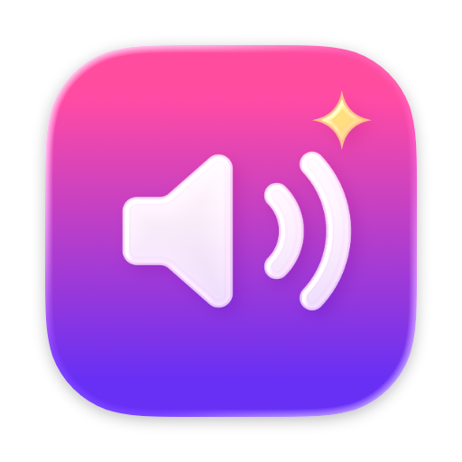
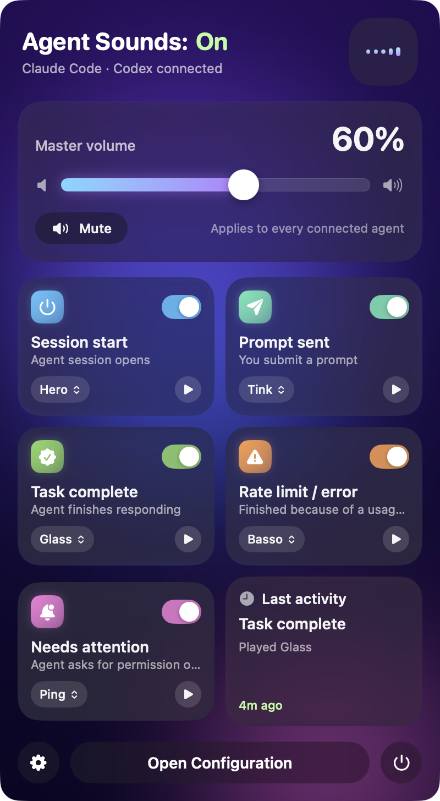
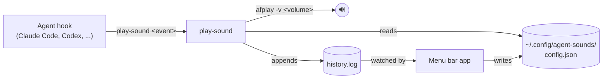

<div align="center">



# Agent Sounds Bar

### Hear what your coding agents are doing. Control it from the menu bar.

**One volume, one mute and one sound per event for Claude Code, Codex and any agent with hooks.**

[](https://github.com/ealexisaraujo/agent-sounds-bar/releases/latest)
[](https://github.com/ealexisaraujo/homebrew-tap)
[](https://github.com/ealexisaraujo/agent-sounds-bar/actions/workflows/ci.yml)
[](#requirements)
[](Sources/AgentSoundsBar)
[](LICENSE)

[Quick start](#quick-start) · [How it works](#how-it-works) · [Events](#events) · [Updates](#updates-and-channels) · [Command line](#command-line) · [FAQ](#faq) · [Development](#development)

<code>brew install --cask ealexisaraujo/tap/agent-sounds-bar</code>

</div>

> [!IMPORTANT]
> Get Agent Sounds Bar from [ealexisaraujo/agent-sounds-bar](https://github.com/ealexisaraujo/agent-sounds-bar/releases)
> or the [ealexisaraujo/homebrew-tap](https://github.com/ealexisaraujo/homebrew-tap) cask. Releases are signed with a
> Developer ID and notarized by Apple. A copy from anywhere else is not an official build.

<div align="center">

<br />



<br /><br />

</div>

---

Coding agents play sounds through hooks: a chime when a task finishes, another when they need your permission. Each agent keeps its own hook commands, so turning the volume down or muting them for a meeting means editing JSON files.

Agent Sounds Bar gives every agent's hooks one shared command, `play-sound`, and one settings file. The menu bar app edits that file: master volume, mute, and which sound plays for each event. The hooks read it every time they fire, so your settings apply to every connected agent at once and keep working when the app is closed.

The first launch connects Claude Code and Codex for you. It shows every change before making it and saves a backup of each file it touches.

## Quick start

### Install

With [Homebrew](https://brew.sh):

```bash
brew install --cask ealexisaraujo/tap/agent-sounds-bar
```

Or download `AgentSoundsBar-<version>.zip` from [Releases](https://github.com/ealexisaraujo/agent-sounds-bar/releases/latest), unzip it and move **AgentSoundsBar.app** to Applications.

### Set it up

Open **Agent Sounds Bar** from Applications. It lives in the menu bar (no Dock icon), and the first launch opens a setup guide:

1. **Install** puts the `play-sound` command and the default settings in `~/.config/agent-sounds/`.
2. **Connect** lists the agents found on this Mac. For each one it shows the hooks it will add or take over, the exact diff on request, and the backup it will save. Nothing changes until you press Connect.
3. **Test** plays each sound and confirms when a real event arrives from your agent.

Then send a prompt in Claude Code or Codex. The menu bar icon dances when a sound plays.

### Stay up to date

The app checks GitHub Releases once a day. When a new version is out, a banner appears in the popover:

- **Homebrew installs** update in one click: the app runs `brew upgrade` and relaunches itself.
- **Direct downloads** open the new release's zip.

You can also run `brew upgrade --cask agent-sounds-bar` at any time. See [Updates and channels](#updates-and-channels).

## How it works



- `config.json` is the only contract between the app and the hooks. It is plain JSON, safe to edit by hand, and the app picks up outside edits right away.
- `play-sound` always exits 0 and returns immediately, so a missing file or a broken config can never slow down or break an agent.
- Every call is logged to `history.log`, including the times nothing played and why (muted, disabled, file missing). The app uses it to animate the menu bar icon and fill the Activity tab.
- The defaults are the sounds built into macOS (`/System/Library/Sounds`), so nothing extra is downloaded. Add your own with **Add sound...** in any event's menu, or drop `.wav .mp3 .aiff .m4a .caf` files into `~/.config/agent-sounds/sounds/`.

## Events

| Event | Agent hook | Default sound | Plays when |
| --- | --- | --- | --- |
| Session start | `SessionStart` | Hero | An interactive session opens (only in a real terminal, so background runs stay quiet) |
| Prompt sent | `UserPromptSubmit` | Tink | You send a prompt |
| Task complete | `Stop` | Glass | The agent finishes its turn |
| Rate limit / error | `Stop` | Basso | The turn ended on a rate-limit, 429, 529 or overload error (read from the transcript) |
| Needs attention | `Notification` | Ping | The agent is waiting on you, such as a permission prompt (Claude Code only; Codex has no such hook) |

### Supported agents

| Agent | Setup |
| --- | --- |
| Claude Code | Connected by the app (`~/.claude/settings.json`) |
| Codex | Connected by the app (`~/.codex/hooks.json`). Codex may ask you to re-approve the changed hooks once. |
| Gemini, Cursor, opencode, others | Copy-paste hook commands from the setup guide's "Other agents" section |

Any agent that can run a shell command on an event can join: call `~/.config/agent-sounds/bin/play-sound <event>`. For `stop`, pass the hook's JSON on stdin so the rate-limit check works.

## Updates and channels

The gear menu in the popover has **Check for Updates...**, an **Update channel** picker and an automatic-check toggle. The Overview tab of the configuration window shows the same controls, plus how the app was installed and when it last checked.

| Channel | You get |
| --- | --- |
| Stable | Finished releases only. The default. |
| Beta | Finished releases plus beta previews (GitHub prereleases such as `v1.1.0-beta.1`). |

Betas are published only on GitHub Releases. The Homebrew cask stays on the latest stable version, so a Homebrew install on the Beta channel downloads betas from the release page instead of upgrading in place.

## Command line

The app's binary doubles as a command line tool for scripting and troubleshooting. Add `--dry-run` to preview any change without writing it.

```bash
APP=/Applications/AgentSoundsBar.app/Contents/MacOS/AgentSoundsBar
$APP status                       # setup state and every agent's hooks
$APP setup [--dry-run]            # install play-sound and the default settings
$APP connect claude|codex|all     # wire an agent's hooks (backup first)
$APP disconnect all               # remove them, restoring anything they replaced
$APP version
$APP check-update [--beta]        # exit 10 when an update is available
```

## Requirements

- macOS 14 Sonoma or later (the Liquid Glass look needs macOS 26)
- `jq`, used by `play-sound`. macOS 15 and later include it; the Homebrew cask installs it on macOS 14.
- At least one agent with hooks, such as [Claude Code](https://claude.com/claude-code) or [Codex](https://github.com/openai/codex)

## FAQ

<details>
<summary><strong>What exactly does Connect change in my agent's files?</strong></summary>

It adds one hook per event that runs `play-sound`, or takes over an existing sound hook it recognizes. Files are edited as text, not re-serialized, so your formatting and every unrelated hook stay exactly as they were, and the result must still parse before it is saved. A timestamped backup is written next to the file before every change. Disconnect removes the hooks and restores anything they replaced. Preview it with `connect all --dry-run`.

</details>

<details>
<summary><strong>Do sounds still play when the app is closed?</strong></summary>

Yes. The hooks run `play-sound`, which reads `config.json` on its own. The app is only needed to change settings and to animate the icon.

</details>

<details>
<summary><strong>Why did Codex ask me to approve its hooks again?</strong></summary>

Codex pins a `trusted_hash` for each hook in `~/.codex/config.toml`. Any change to a hook command, including the one Connect makes, asks you to trust it once more. That's expected.

</details>

<details>
<summary><strong>A sound didn't play. How do I find out why?</strong></summary>

Open **Configuration > Activity**. Every hook call is listed with its result: played, muted, disabled, volume at zero, or sound file not found. **Overview > Health** checks the install, `jq`, the config file and each agent's hooks.

</details>

<details>
<summary><strong>How do I uninstall it?</strong></summary>

Remove the hooks first, then the app:

```bash
/Applications/AgentSoundsBar.app/Contents/MacOS/AgentSoundsBar disconnect all
brew uninstall --zap --cask agent-sounds-bar   # or drag the app to the Trash
```

`--zap` also deletes `~/.config/agent-sounds` (settings, your added sounds and the history log).

</details>

## Development

```bash
./build.sh                          # build/AgentSoundsBar.app (ad-hoc signed, native arch)
open build/AgentSoundsBar.app
swift test                          # Swift tests: hook connector, JSON editing, installer, updates
tests/test-play-sound.sh            # play-sound tests with a fake player, silent
```

`AGENT_SOUNDS_HOME`, `AGENT_SOUNDS_USER_HOME` and `AGENT_SOUNDS_PLAYER` point the script and the app at a temp directory and a fake player, so experiments never touch your real config, agents or speakers. Building the app icon needs Xcode (`actool`); without it the app builds without an icon.

Releases are cut with `scripts/release.sh build` (universal build, Developer ID signing, notarization, stapling) and `scripts/release.sh publish` (GitHub release plus the Homebrew cask). The version lives in [`VERSION`](VERSION) and the notes in [`CHANGELOG.md`](CHANGELOG.md).

## Contributing

Bug reports and pull requests are welcome. [Open an issue](https://github.com/ealexisaraujo/agent-sounds-bar/issues) with your macOS version, the agent, and what the Activity tab shows. Pull requests should keep both test suites passing. `play-sound` must always exit 0.

## License

[MIT](LICENSE) © 2026 Enrique Alexis Araujo

The default sounds are not part of this project: they are the system sounds that ship with macOS and are played from `/System/Library/Sounds`. Claude Code, Codex and other product names belong to their owners. This project is not affiliated with Anthropic or OpenAI.
